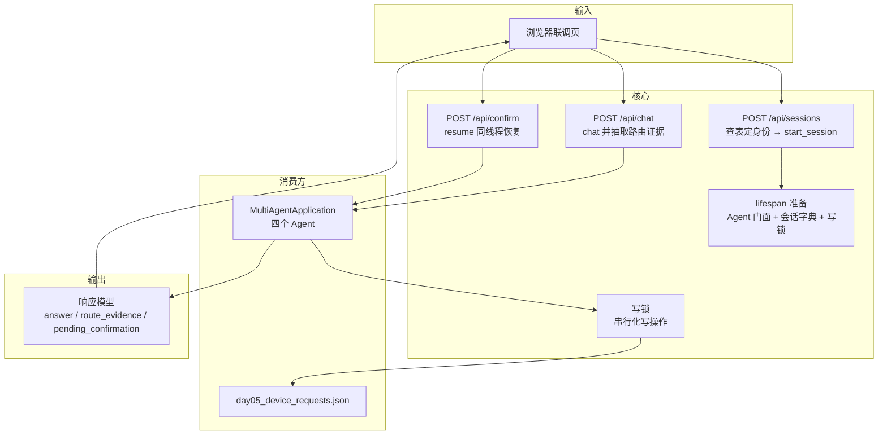

# 把多 Agent 应用封装成 Web API —— 实现路径

## 0. 定位与档位声明

**本文档的层级与档位：模块级 · 设计文档。** 只覆盖"给现有 `MultiAgentApplication` 套一层 HTTP 接口"这一个模块，不外扩到架构级取舍（如是否引入消息队列、是否做多租户），也不是流程规范。

**需求方原话**（`m01080`、`m01098`）：

> 「我想要为当前项目封装接口，用于接入前端；把生成的文档存到 dosc 文件夹下面」
> ＋「参考这份文档」→ `C:\Users\Administrator\Desktop\课程\agent教程\周十六\Day02_将Agent封装成WebAPI.md`

**这句话一开始缺哪些决策**（这就是本流程要补的东西）：接口用自研路由还是 LangGraph 自带服务；会话与 LangGraph Thread 怎么对应；写操作的"暂停—确认—恢复"怎么落到 HTTP 上；身份从哪来、`role` 由谁定；失败怎么表达；并发底线到哪。

**为什么重心是"验证与补充"而不是"成形"**：那份课件本身就是完整的施工规格（`lifespan`、数据合同、会话接口、`interrupt` 转换、`StaticFiles`+CORS、验证链路一应俱全），且它假定的输入正是本项目的 `start_session()` / `chat()` / `resume()`。按流程的"输入信息量决定产出重心"条款，本文档**不复述课件已有内容**，只做三件事：①**对标验证**（别人的做法是印证还是反驳它）②**缺口与待裁决项**（它没覆盖的机制选择）③**可执行落地路径**。

---

## 1. 业务实现叙事

一句话：**把"终端里一个人打字"变成"浏览器里每个人各自一个会话，且写操作仍然要人点确认"。**

### 阶段一：起服务

进程启动时准备好**一个** `MultiAgentApplication` 实例（四个 Agent、一个向量库句柄都挂它身上），并检查向量库存在。这一段之所以要"一次准备、全程复用"，是因为每次请求都重建 Agent 会重复加载 embedding 模型（实测建库/加载耗时秒级），课堂演示下不可接受。

**字段设计**

| 字段 | 为什么需要 | 取值示例 | 谁在用 |
| --- | --- | --- | --- |
| `app` | 全局唯一的 Agent 门面 | `MultiAgentApplication(...)` | 所有路由 |
| `sessions` | `session_id` → 会话对象的索引 | `{"s-8f3a": UserSession(...)}` | 三个业务接口 |
| `write_lock` | 串行化文件写入的进程内锁 | `threading.Lock()` | 写操作的业务 Tool |

### 阶段二：开一个浏览器会话

浏览器先要"我是谁"。本项目身份不是密码，而是**教学账号**：前端发 `username`，**服务端** `login_as(username)` 查 `src/data/day05_users.json` 得到 `role` 与 `department_id`，再调 `start_session()` 建一个 `UserSession`（内部带 `thread_id` 与 `RunContext`）。服务端把 `session_id` 发回前端。

**关键点**：`role` 一律由服务端查表得出 —— 客户端哪怕传了 `role` 也忽略。因为本项目有三道权限闸门全靠 `RunContext.role`：Supervisor 按角色裁剪 Agent Tool、业务 Tool 内部重读 `role`、检索期按 `allowed_roles` 过滤。身份一旦可被客户端指定，三道闸门同时失效。

**字段设计**

| 字段 | 为什么需要 | 取值示例 | 谁在用 |
| --- | --- | --- | --- |
| `session_id` | 浏览器侧唯一句柄；服务端靠它找回 `UserSession` | `"s-8f3a1c"` | 三个业务接口 |
| `username` | 唯一身份输入 | `"zhang_wei"` | `login_as()` |
| `display_name` / `role` | 回给前端显示"我现在是谁" | `"张伟"` / `"employee"` | 前端顶栏、权限对照演示 |

### 阶段三：问一句、答一句

前端发 `session_id` + `message`。服务端取出该会话，调 `chat(session, message)` —— **只提交本轮新消息**，历史由 checkpointer 按 `thread_id` 回放。回来的结果里既有最终回答，也有路由证据（`outer_trace()` 抽出的"调了哪个 Agent Tool、内层用了哪些业务 Tool"）。

**字段设计**

| 字段 | 为什么需要 | 取值示例 | 谁在用 |
| --- | --- | --- | --- |
| `message` | 用户这一轮说的话 | `"公司介绍里说北京总部主要承担哪些职能？"` | `chat()` |
| `answer` | 最终回答 | `"北京总部主要承担六类职能…"` | 前端气泡 |
| `route_evidence` | **事后可见**的调用轨迹（本次痛点只取这一半） | `[{"agent_tool":"ask_knowledge_agent","business_tools":["search_company_knowledge"]}]` | 前端折叠面板、验收 |
| `pending_confirmation` | 本轮是否停在"等人确认" | `true` / `false` | 前端决定要不要弹确认条 |
| `confirmation` | 待确认载荷原文 | `{"action":"create_device_request","candidate":{…}}` | 确认弹窗 |

### 阶段四：写操作停下来等人

这是全篇最关键的一段。用户说"我想申请一台显示器，24 英寸的"，Agent 不会直接写盘：业务 Tool 内部调用 LangGraph 的 `interrupt()`，信号一路冒泡到最外层，`chat()` 的返回值里就带上了 `__interrupt__`。服务端把它转成 JSON 交给前端，前端弹出确认条。

用户点"确认"→ 前端发 `POST /api/confirm` `{session_id, approved: true}` → 服务端用**同一个 `thread_id` 与同一个 `RunContext`** 调 `resume(session, approved=True)` → 写盘落定。点"拒绝"则 `approved: false`，**一个字节都不写**。

**贯穿样例（同一份数据穿到底）**：张伟（`USR-001`）申请 `DEV-MONITOR-24` ×1。确认后 `src/data/day05_device_requests.json` 从 18 条变 19 条，新记录 `applicant_user_id=USR-001`、`status=pending`、`request_id=REQ-2026-0019`；随后王芳（HR）在自己的会话里批准它，`status` 变 `approved`、`reviewer_user_id` 变 `USR-003`。**拒绝路径**用同一条数据验证：字节数与 sha256 不变（`7730` / `0e23b39cd1eb3022`）。

**字段设计**

| 字段 | 为什么需要 | 取值示例 | 谁在用 |
| --- | --- | --- | --- |
| `approved` | 人做的那个决定 | `true` / `false` | `resume()` |
| `applicant_user_id` | 申请人，来自 `RunContext` 而非请求体 | `"USR-001"` | 落盘记录、隔离断言 |
| `request_id` | 落盘后的真实编号 | `"REQ-2026-0019"` | 后续审批 |

### 阶段五：并发与失败

两个标签页同时是两个人。会话层面天然隔离（各自 `session_id` → 各自 `thread_id`）；但**写操作会撞车**：业务数据是文件式读-改-写，两次并发提交会 last-write-wins 丢一条。处置是把写操作放进进程内 `threading.Lock` 串行化 —— 单进程前提下这就够了。

失败则对外统一 `503`（不泄露堆栈、路径、网关细节），服务端日志里记完整异常。这条不是洁癖：本项目真的撞过一次 `OpenAIConnectionError: Connection error.`（瞬时网络抖动），用户看到的应是"服务暂时不可用"，而不是一段栈。

### 业务诉求 → 阶段 → 字段 → 决策 全表

| 业务诉求 | 落在哪个阶段 | 关键字段 | 对应决策 |
| --- | --- | --- | --- |
| 浏览器能提问并拿到回答 | 阶段三 | `message` `answer` | `R2` `D1` |
| 看得到它做了什么（痛点 `L0-P1`） | 阶段三 | `route_evidence` | `R1` |
| 写操作必须人点确认 | 阶段四 | `pending_confirmation` `confirmation` `approved` | `R3` `D2` |
| 员工/HR 权限差异可演示 | 阶段二 | `username` `role` | `R4` |
| 两个标签页不串 | 阶段二/五 | `session_id` | `D3` |
| 同时写不丢数据 | 阶段五 | `write_lock` | `R5` |
| 出错不吓人、不泄密 | 阶段五 | —— | `D4` |

---

## 2. 最终设计决策表

### 2.1 天花板条目（R 级，需逐条确认）

**`R1` 可见性到哪一层 —— "中间过程给前端看多少"**
- 要什么：让用户看得见 Agent 干了什么，但不引入流式。
- 备选：① 只回最终回答 ② **回最终回答 + 路由证据** ③ 实时流式（SSE）。
- 权衡：②能用现有 `outer_trace()` 直接产出，零新增机制；③要改接口形态与前端，且课件把它划给 Day03。
- 推荐与理由：**②**（用户 `m01121` 已选 `B1 事后可见`）。因为痛点 `L0-P1` 的一半（"不知道它干了什么"）能在档位 B 内解决，另一半（"边跑边显示"）明确留给 Day03。
- **放弃的代价**：放弃"逐字输出与实时工具状态"；慢响应的那 10–30 秒里前端只能转圈，不能显示进度。

**`R2` 接口怎么获得 —— "自研路由还是用现成服务"**
- 要什么：用最小代价把三个方法暴露成 HTTP。
- 备选：① **自研 FastAPI 路由直调三方法** ② 跑 LangGraph 自带 API 服务，前端直连 ③ 仿开源项目自建带流式的端点。
- 权衡：①贴合课件与"今天不拆服务层"；②要额外进程与平台语义，且本项目是四个 Agent 实例＋每会话重建模型，与"单 graph"模型不齐；③要自己实现事件归一，而档位 B 不要流式。
- 推荐与理由：**①**（用户 `m01189` 选 `A1`）。理由：三个方法已经齐备，接口层只是薄转换；②③的复杂度都买不到本次需要的收益。
- **放弃的代价**：放弃 LangGraph 平台自带的多线程管理、断线重连、`/threads` 标准协议，以及 `langchain-ai/agent-chat-ui` 这类现成前端的"开箱即用"。

**`R3` 中断恢复怎么建模 —— "session 还是 checkpoint"**
- 要什么：让前端完成"暂停—确认—恢复"，但不把 LangGraph 概念泄给前端。
- 备选：① **会话即线程**（`session_id` → `UserSession` → `thread_id`）② 把 `checkpoint_id` 显式暴露给前端。
- 权衡：①前端只需 `session_id`；②更贴近原生，但本项目 `resume()` 内部只用 `thread_id`（`_config(session)` 只塞 `thread_id`），改造为 `checkpoint_id` 属于"为了对齐别人而改自己"。
- 推荐与理由：**①**（用户 `m01189` 选 `B1`）。
- **放弃的代价**：放弃"对同一线程的多个历史断点做精确重放"的能力（本项目一次只停一个点，用不上）。

**`R4` 身份从哪来 —— "谁能声明自己是 HR"**
- 要什么：既要能在页面上演示员工/HR 差异，又不让权限闸门失效。
- 备选：① **页面选教学账号，服务端查表定 `role`** ② 服务端写死一个账号 ③ 真密码/Token。
- 权衡：①与课件"用户名模拟登录"一致，且能演示权限差异；②演示不了权限；③属 Day05。
- 推荐与理由：**①**（用户 `m01121` 选 `A`）。**硬约束**：客户端传 `role` 必须忽略。
- **放弃的代价**：放弃"真实认证"；`session_id` 只是钥匙，**不证明身份** —— 拿到它就能用那个会话。

**`R5` 写操作并发 —— "同时点确认会怎样"**
- 要什么：兑现 `L0-C7`（两标签页含写操作不串）。
- 备选：① **进程内 `threading.Lock` 串行化写** ② 单写者队列 ③ 不做保护。
- 权衡：①约十行，正好匹配单进程；②在单进程课堂场景收益不明显；③会丢更新。
- 推荐与理由：**①**（用户 `m01189` 选 `C1`）。
- **放弃的代价**：放弃多进程/多实例部署下的写安全（本档位没有多进程，故无损失）。

### 2.2 打包默认项（D 级，显式列出，不反对即通过）

| 编号 | 意图（要什么） | 决策 | 依据 |
| --- | --- | --- | --- |
| `D1` | 接口长什么样 | `POST /api/sessions`、`POST /api/chat`、`POST /api/confirm`、`GET /api/health`、`GET /`（联调页） | 课件 §7–§10 |
| `D2` | 确认怎么表达 | 响应带 `pending_confirmation` + `confirmation` 载荷；确认走独立接口 | `R3` |
| `D3` | 会话存哪 | 进程内存字典 `{session_id: UserSession}`；重启即失效 | `H2` |
| `D4` | 失败怎么表达 | 统一 503；完整异常只进服务端日志 | 用户 `m01121` 选 `A` |
| `D5` | 页面怎么托管 | `app.mount()` + `StaticFiles`，同源，不配 CORS | 用户 `m01189` 选 `D1` |
| `D6` | 同步调用怎么写路由 | 用普通 `def`（FastAPI 会丢线程池），不用 `async def` | 课件 §9.2 |

### 2.3 决策依据（对标发现的缺口 → 决策）

| 要什么 | 现状缺口 | 后果 | 对标印证 | 驱动决策 |
| --- | --- | --- | --- | --- |
| 一次准备、全程复用 Agent | 现有 `main.py` 是"一个进程一个人" | 若每请求重建，重复加载 embedding，响应被拖长 | 课件把准备动作放进 `lifespan` | `D1` |
| 每会话独立的网关会话头 | 本项目 `start_session()` 会重建模型以带新的 `x-opencode-session` | 若共用，网关侧路由/缓存跨会话复用 | 课件未涉及（它的 Agent 不要求会话头） | `D3` ＋ `R2` |
| 写操作不丢更新 | 业务数据是文件式读-改-写 | 两标签页同时写会丢一条 | 课件用内存字典存**会话**，未涉及业务数据并发 | `R5` |
| 回调不泄密 | 现有 CLI 直接把异常打成一行 `本轮执行失败：…` | 上浏览器后可能暴露路径/网关细节 | 课件 §13.5 明确"浏览器只看到统一的 503" | `D4` |

---

## 3. 量级与估算

本表数字均带四类标记（`[实测]`／`[假设]`／`[外源]`／`[推导]`）；编码完成后须回填者见 §9.1。

| 量 | 值 | 标记与口径 |
| --- | --- | --- |
| 并发会话数 | 1–3 个标签页 | `[假设]`。依据 `L0-C3`（本地单进程、本人使用）。错了会怎样：若真上到几十并发，内存字典与进程内锁都还够用，但**单进程单事件循环**下的模型调用会排队，响应变慢 |
| 单轮响应时间 | 10–30 秒 | `[实测]`。口径：本机 `deepseek-v4.1-flash` 走网关，含 1–3 次工具调用；CLI 实测区间 |
| 建库/加载 embedding | 秒级（首次数分钟） | `[实测]`。口径：`build_index.py` 全程约 2–3 分钟（含首次模型下载）；每次新进程首次检索加载模型 |
| 进程内存驻留 | 数十字节级会话 + 一个 Agent 门面 | `[推导]`。会话对象仅持 `RunContext`＋`thread_id`＋Supervisor 引用；大头是四个 Agent 与 embedding 模型常驻 |
| 业务数据文件 | 7730 字节 / 18 条 | `[实测]`。`src/data/day05_device_requests.json`，sha256 前缀 `0e23b39cd1eb3022` |
| 单条申请新增 | 约 200 字节 | `[推导]`。第 19 条 `REQ-2026-0019` 落盘后文件由 7730 变 7730+ε |

**覆盖声明**：上表覆盖"服务侧"的量（并发、延迟、内存、数据规模）。**未覆盖**：前端侧渲染开销、浏览器与服务端之间的网络往返（本轮定为同源本地）。

---

## 4. 契约与边界

| 编号 | 契约要求 | 入库前断言 | 违约处置 |
| --- | --- | --- | --- |
| `C1` | `POST /api/sessions` 的 `username` 必须是 10 个可登录教学账号之一 | 调 `login_as(username)`，捕获 `ValueError` | 返回 4xx 并附"未找到可登录的教学账号"；**不得**创建半成品会话 |
| `C2` | 请求体里的 `role` **永不采信** | 请求模型中**不定义** `role` 字段 | 即使客户端多传，Pydantic 忽略；若有人日后加了该字段，代码评审必须拦下 |
| `C3` | 三个业务接口的 `session_id` 必须存在 | 查 `sessions` 字典 | 不存在返回 404 且提示"会话不存在或已重启失效" |
| `C4` | `chat`/`confirm` 必须复用同一 `thread_id` 与 `RunContext` | 取 `session.thread_id` / `session.context`，禁止新建 | 若发现新建，断言失败（第二轮回问会丢上下文，`L0-C7` 直接破） |
| `C5` | 写操作在锁内执行 | `with write_lock:` 包裹写路径 | 无锁即并发丢更新；验收第 6 条会以"字节数不变"打脸拒绝路径 |
| `C6` | 拒绝必须零写入 | 比对文件字节数与 sha256 | 变化即判失败 |
| `C7` | 对外错误不得含内部细节 | 统一 `HTTPException(503)` | 任何把 `str(exc)` 直接回传的写法都不合格 |
| `C8` | 响应中的 `route_evidence` 必须来自真实调用轨迹 | 由 `outer_trace(result)` 生成，不得手写 | 手写即造假证据 |

---

## 5. 对标结论

**主对标是需求方指定的课件**（不是开源仓库）—— 按流程的"验证与补充"要求，先回答"社区做法是印证还是反驳它"。

| 对标 | 链接 | 为什么参考 | 为什么不全抄 |
| --- | --- | --- | --- |
| **课件 Day02**（主对标，用户指定） | 本地 `C:\Users\Administrator\Desktop\课程\agent教程\周十六\Day02_将Agent封装成WebAPI.md` | 它的假定输入**正是**本项目的 `start_session()`/`chat()`/`resume()`（课件 §2.3 明列这三个方法），`lifespan`＋数据合同＋联调页的结构与我们的档位完全对齐 | 它的边界表（§12）只覆盖"内存字典存会话"，**没覆盖本项目的两处真实差异**：① `start_session()` 会重建模型以带每会话 `x-opencode-session`（多标签页并发开会话时会互相覆盖 `self.model`）② 业务数据是文件式读-改-写（并发写丢更新）。这两条本文档用 `D3` 与 `R5` 补 |
| `langchain-ai/langgraph` | https://github.com/langchain-ai/langgraph | 42943★、MIT、Python、`pushed_at` 2026-10-08（高度活跃）；`libs/cli` 是该框架自带 API 服务的入口 —— 这是 `R2` 备选②的**存在性证据** | 平台服务面向"单 graph + 平台线程模型"，与本项目"四实例 + 每会话重建模型 + 网关会话头"不齐；采用它等于把本次的薄接口换成一套部署，与档位 B 的"不拆服务层"冲突 |
| `foreveryh/mentis` | https://github.com/foreveryh/mentis | 搜到的**最贴近本需求**的实现：`api/server.py` 里 `input_for_astream = Command(resume=body.get("resume"))`，即"HTTP 请求体里的 resume 字段直接喂给 `Command(resume=...)`" —— 印证 `R3` 的"暂停—恢复"确实可以落在 HTTP 上 | 它把 `config["configurable"]["checkpoint_id"] = body.get("resume")` 一起设了，把 checkpoint 概念泄给前端；我们按 `R3` 只用 `thread_id`。⚠️ **诚实标注**：该文件的**全量读取失败**（GitHub MCP 返回 `[embedded resource unsupported; raw resource data remains available to programmatic callers]`），以上两行来自 `search_code` 的 `text_matches` 片段，属**片段级**代码证据，非通读 |
| `nicoladisabato/MultiAgenticRAG` | https://github.com/nicoladisabato/MultiAgenticRAG | `app.py` 里先判 `if len(graph.get_state(thread)[-1][0].interrupts) > 0:` 再决定是否 `graph.astream(Command(resume=...), stream_mode="messages", config=thread)` —— 印证"先检查有没有中断、再恢复"这个顺序是社区通用写法 | 它走 `astream` 流式，本档位不做流式；它的判断写法对我们有参考价值（用来决定 `pending_confirmation`），但不是必须 |
| `langchain-ai/agent-chat-ui` | https://github.com/langchain-ai/agent-chat-ui | 3207★、MIT、TypeScript、`pushed_at` 2026-10-06；官方"任何 LangGraph Agent 的聊天前端" | 它是**前端**且面向 LangGraph 平台的 `/threads`、`/runs/stream` 协议 —— 采用它等于被迫走 `R2` 的备选②。列在此处是为了说明 `R2` 选①时**被放弃的具体收益** |

**缺口清单**（对标没给、必须自己补的）：

| 缺口 | 谁补 | 对应决策 |
| --- | --- | --- |
| 每会话独立的 `x-opencode-session`（网关要求）与多标签页并发开会话的 `self.model` 覆盖 | 本项目 | `D3` |
| 文件式业务数据的并发写丢更新 | 本项目 | `R5` |
| 身份必须服务端查表定 `role`（客户端不可指定） | 本项目 | `R4` |
| `reasoning_content` 回传（thinking 模型 + 该网关的硬要求） | 本项目既有实现 | §9 已知限制 |

---

## 6. 模块全景

**一句话定义**：在现有 `MultiAgentApplication` 外面套一层**只做协议转换**的 FastAPI 薄壳 —— 它不含业务逻辑，只负责"把 HTTP 请求翻译成三个方法调用，把返回值翻译成 JSON"。

**做什么 / 不做什么**

| 做 | 不做 |
| --- | --- |
| 三个业务接口 + 健康检查 + 联调页 | 认证、Token、密码（Day05） |
| 会话 ↔ 线程的映射与查找 | 持久化、多进程（Day04） |
| `interrupt` → JSON → `resume` 的转换 | SSE / 实时流式（Day03） |
| 路由证据抽取（事后可见） | 服务层/路由层拆分 |
| 写操作串行化 | 正式前端框架 |

**步骤拼装关系**：`P0` 起骨架 → `P1` 数据合同（字段在此定死）→ `P2` 会话接口 → `P3` 对话接口（含证据抽取）→ `P4` 确认接口 → `P5` 写锁 → `P6` 联调页 → `P7` 失败与验收串联。

**步骤划分依据**：本需求的数据流链是「**启动准备 → 身份定档 → 会话建档 → 单轮问答 → 证据抽取 → 确认恢复 → 落盘串行化 → 对外收口**」。`P0–P7` 严格按这条链切，不套用其它需求的骨架。

---

## 7. 分步实现路径

### P0 起骨架：应用、准备与健康检查

- **目标**：`GET /api/health` 能返回 `{"status":"ok"}`，且启动时已完成 Agent 门面准备与建库检查。
- **执行流程**：新建 `webapp.py`（不叫 `main.py`，避免与 CLI 入口混淆）→ 定义 `lifespan` → 在其中检查向量库并构造 `MultiAgentApplication` 存入 `app.state` → 建会话字典与写锁 → 挂健康检查。
- **提示词模板**（Spec 模式）：

  用 FastAPI 新建 `webapp.py`：在 `lifespan` 里做两件事——检查 `INDEX_MANIFEST_PATH` 是否存在（不存在就报"尚未构建向量库，请先运行 build_index.py"），并构造**一个** `MultiAgentApplication` 实例放进 `app.state`；同时准备 `sessions: dict[str, UserSession]` 与 `write_lock: threading.Lock()`。只加 `GET /api/health`。**不要**定义任何业务接口，**不要**改 `multi_agent.py` 或 `business_tools.py` 里的任何逻辑，**不要**用 `async def` 写会调 Agent 的路由。

- **通过信号**：`uv run python -m uvicorn webapp:app --reload` 起得来；`curl 127.0.0.1:8000/api/health` 返回 200 与 `{"status":"ok"}`；把 `src/vector_store/index_manifest.json` 临时改名后启动，进程**立即失败**并打印"尚未构建向量库…"。
- **翻车信号**：启动后第一次提问才报"尚未构建向量库"→ 说明检查放错位置（应放 `lifespan`）；`/api/health` 不在 `/docs` 里 → 说明跑的不是这个文件。
- **验收证据**：`curl` 输出片段 + 临时改名后启动失败的完整输出。
- **来源**：`L0-S1` `L0-C8` `D1` `V1`

### P1 数据合同：请求与响应模型

- **目标**：四类请求体、两类响应体定义完毕，且**请求体里没有 `role`**。
- **执行流程**：用 Pydantic 定义 `CreateSessionRequest{username}`、`ChatRequest{session_id, message}`、`ConfirmRequest{session_id, approved}`；`RouteEvidence{agent_tool, business_tools}`、`ChatResponse{answer, route_evidence, pending_confirmation, confirmation?}`、`SessionResponse{session_id, display_name, role}`。
- **提示词模板**（TDD 模式）：

  为上面的接口定义 Pydantic 模型。**硬要求**：`CreateSessionRequest` 只允许 `username` 一个字段，**绝对不要**加 `role`、`user_id`、`department_id`（身份一律服务端查表得出）。先写这两个断言测试：① `CreateSessionRequest(username="zhang_wei", role="hr")` 构造后**没有** `role` 属性；② `ChatResponse` 的 `route_evidence` 默认空列表而非 `None`。

- **通过信号**：两个断言测试通过；`/docs` 的 Schemas 里 `CreateSessionRequest` 只有 `username`。
- **翻车信号**：`/docs` 里看到 `role` 可选字段 → 立刻删；`route_evidence` 是 `None` 导致前端要判空 → 改成默认 `[]`。
- **验收证据**：`/docs` 页面截图或 `curl /openapi.json | grep -A3 CreateSessionRequest` 的输出。
- **来源**：`L0-C5` `C2` `R4`

### P2 会话接口：把身份钉在服务端

- **目标**：`POST /api/sessions {username}` 返回 `session_id/display_name/role`；同一浏览器刷新后可继续用旧 `session_id`。
- **执行流程**：取出 `app.state.sessions` → 调 `app.state.agent.start_session(username)`（内部已 `login_as` 查表）→ 生成 `session_id` 存入字典 → 返回三字段。捕获 `ValueError` 转 4xx。
- **提示词模板**（Spec 模式）：

  实现 `POST /api/sessions`：调用 `MultiAgentApplication.start_session(username)` 建会话，把返回的 `UserSession` 存进 `app.state.sessions[session_id]`，并返回 `session_id`、`display_name`、`role`（都取自 `session.context`）。登录失败（`login_as` 抛 `ValueError`）要返回 4xx 与"未找到可登录的教学账号"，**不要**返回 500，**不要**在失败时往 `sessions` 里塞任何东西。

- **通过信号**：`curl -X POST /api/sessions -d '{"username":"wang_fang"}'` 返回 `role:"hr"`；传 `"zhang_wei"` 返回 `role:"employee"`；传 `"张伟"` 返回 4xx 且 `sessions` 长度不变。
- **翻车信号**：只要传任意字符串都能建会话 → `login_as` 的校验被绕过；`role` 跟着请求体的值变 → `C2` 被破，必须立刻回退。
- **验收证据**：两次 `curl` 的 JSON + 失败时 `len(app.state.sessions)` 不变的日志。
- **来源**：`L0-S2` `L0-C5` `C1` `R4`

### P3 对话接口：一次调用 + 证据抽取

- **目标**：`POST /api/chat` 返回回答与路由证据；第二轮沿用同一 `thread_id`。
- **执行流程**：查 `sessions[session_id]`（无则 404）→ `agent.chat(session, message)` → 用 `outer_trace(result)` 生成 `route_evidence` → 检查 `result.get("__interrupt__")` 决定 `pending_confirmation` 与 `confirmation` 载荷 → 组装 `ChatResponse`。
- **提示词模板**（Spec 模式）：

  实现 `POST /api/chat`。取会话后调 `chat(session, message)`；回答取最后一条**没有 tool_calls** 的 `AIMessage` 的内容；路由证据由 `outer_trace(result)` 生成（Agent Tool 名放 `agent_tool`，其 `ToolMessage` 里 JSON 的 `business_tools` 放 `business_tools`）——**不要**自己拼字符串、**不要**把检索原文塞进响应。若 `result` 里有 `__interrupt__`，把第一个中断的 `value` 放进 `confirmation` 且 `pending_confirmation=True`，本轮**不得**写任何数据。

- **通过信号**：`curl "公司介绍里说北京总部主要承担哪些职能？"` 返回的 `route_evidence` 里出现 `ask_knowledge_agent` 与 `search_company_knowledge`；**同一个 `session_id` 再发**「那上海那边呢？」时，证据里出现新的 `ask_knowledge_agent` 且回答确实在讲上海（证明 `thread_id` 被复用）。
- **翻车信号**：第二轮回答"我不知道你指哪里" → `thread_id` 没复用（`C4` 被破）；`route_evidence` 里出现前端没见过的工具名 → 一定是手写而非 `outer_trace` 生成。
- **验收证据**：两次 `curl` 的 `route_evidence` 与第二轮回答前 120 字。
- **来源**：`L0-S3` `L0-S5` `L0-C4` `C4` `C8` `R1`

### P4 确认接口：同线程恢复

- **目标**：`POST /api/confirm` 能把停在确认的会话推下去；`approved:false` 时业务数据**零变化**。
- **执行流程**：查会话 → 调 `agent.resume(session, approved=approved)` → 复用与 `P3` 相同的响应组装 → 返回。
- **提示词模板**（Spec 模式）：

  实现 `POST /api/confirm`：用**同一个** `session`（即同一个 `thread_id` 与 `RunContext`）调 `resume(session, approved=approved)`，响应结构与 `/api/chat` 完全一致。**不要**新建会话、**不要**改 `thread_id`、**不要**在服务端记录"用户已确认"这类旁路状态 —— 真相只在 LangGraph 的 checkpointer 里。

- **通过信号**：走一遍"申请显示器 → 收到 `pending_confirmation:true` → `confirm{approved:true}`"，`src/data/day05_device_requests.json` 由 18 条变 19 条且新记录 `applicant_user_id=USR-001`、`status=pending`；再走一遍但 `approved:false`，文件**字节数与 sha256 完全不变**。
- **翻车信号**：确认后报"没有待恢复的中断" → `thread_id` 或 Context 变了；拒绝后文件仍变大 → `interrupt` 被绕过或 `resume` 用了新线程。
- **验收证据**：两个分支下的文件字节数/sha256/条数三元组。
- **来源**：`L0-S4` `L0-S10` `C4` `C6` `R3`

### P5 写锁：把并发写撞车堵掉

- **目标**：两个标签页同时提交写操作，两条记录都在，没有 last-write-wins。
- **执行流程**：在服务端写路径（调用会落盘的接口那一段）用 `with app.state.write_lock:` 包住 —— 包在**接口层**而不是改 `business_tools.py`，以保持"不改 Agent 内部逻辑"。
- **提示词模板**（Spec 模式）：

  把 `/api/chat` 与 `/api/confirm` 里**会触发写操作**的调用放进 `with app.state.write_lock:`。**不要**去改 `business_tools.py`（那份代码已由另一个验收套件覆盖，改了会破坏既有证据）。**不要**引入 `asyncio.Lock`（本档位路由是同步 `def`，跑在线程池里，要的是线程锁）。

- **通过信号**：用两个终端并发发同一条"批准申请"请求，两次响应都不报错，且落盘后的状态是两次结果之一（**不是**丢了一条的中间态）；并发发两条不同申请，文件里**两条都在**。
- **翻车信号**：并发之后条数只加了一条 → 锁没生效或没用上（`threading.Lock` 被写成 `asyncio.Lock` 是常见错）；服务端出现 "database is locked" 类错误 → 说明锁的粒度套错了地方。
- **验收证据**：并发脚本输出 + 落盘后条数。
- **来源**：`L0-C7` `R5`

### P6 联调页：同源、够用即止

- **目标**：`GET /` 打得开一个页面，能建会话、发消息、显示回答与路由证据、在需要确认时弹出确认条。
- **执行流程**：建 `static/` 目录放一个单页 HTML（原生 fetch）→ `app.mount("/static", StaticFiles(directory=...))` → `GET /` 返回它。
- **提示词模板**（Spec 模式）：

  写一个**只用于联调**的单页 HTML：顶部选教学账号并"开始会话"，中间显示对话气泡，气泡下方折叠显示 `route_evidence`；当响应 `pending_confirmation=true` 时出现"确认/拒绝"两个按钮，分别 POST `/api/confirm`。用原生 `fetch`，**不要**引入任何前端框架、**不要**配 CORS（同源）、**不要**为了好看花时间在样式上。

- **通过信号**：浏览器里能完整走通「选 zhang_wei → 问公司介绍 → 看到回答与证据 → 申请显示器 → 弹确认 → 拒绝 → 文件字节数不变」。
- **翻车信号**：控制台报 CORS 错 → 说明页面不是同源加载的（检查是不是用了 `file://` 打开）；确认按钮点了没反应 → 检查是不是把 `approved` 发成了字符串 `"true"`。
- **验收证据**：一次完整走查的截图或浏览器 Network 面板里那几条请求。
- **来源**：`L0-S7` `D5` `H3` `H4`

### P7 失败收口与验收串联

- **目标**：模型/工具报错时浏览器只看到统一 503；§8 的验收清单全绿。
- **执行流程**：加异常处理器或路由级 `try/except`，把内部异常转成 `HTTPException(503)` 并 `logger.exception(...)` 留全栈；随后按 §8 逐条跑。
- **提示词模板**（Spec 模式）：

  把所有会调模型/工具的路由的异常处理收口：内部异常统一转 `HTTPException(status_code=503, detail="服务暂时不可用，请稍后重试")`，同时用 `logging.exception` 把完整异常写进服务端日志（含时间戳）。**绝对不要**把 `str(exc)`、堆栈、文件路径、网关地址放进响应体。

- **通过信号**：把 `.env` 的 `BASE_URL` 临时改成一个不可达地址后提问，浏览器拿到 503 与那句中文提示，**响应体里不含** `opencode`、`Traceback`、`E:\` 任一字符串；同时服务端日志里有完整的 `OpenAIConnectionError` 记录。
- **翻车信号**：响应体里出现 `Traceback` 或路径 → `C7` 被破；返回 500 而不是 503 → 没接住。
- **验收证据**：503 响应体全文 + 服务端日志对应片段。
- **来源**：`L0-C6` `C7` `D4`

---

## 8. 验收清单

| # | 验收项 | 可观察证据（第三方可复现） |
| --- | --- | --- |
| 1 | 健康检查可达 | `curl 127.0.0.1:8000/api/health` → 200 + `{"status":"ok"}` |
| 2 | 无索引立即失败 | 临时改名 `src/vector_store/index_manifest.json` 后启动 → 进程退出且输出含"尚未构建向量库，请先运行 build_index.py" |
| 3 | 身份由服务端定 | `curl -X POST /api/sessions -d '{"username":"wang_fang"}'` → `role:"hr"`；`'{"username":"x"}'` → 4xx |
| 4 | 请求体无 role 可传 | `curl /openapi.json` 里 `CreateSessionRequest` 的 `properties` 只有 `username` |
| 5 | 多轮不丢上下文 | 同一 `session_id` 连发两句，第二条 `route_evidence` 非空且回答切题 |
| 6 | 拒绝零写入 | `approved:false` 前后 `src/data/day05_device_requests.json` 的 `(字节数, sha256前16位, 条数)` 三元组完全一致 |
| 7 | 确认真落盘 | `approved:true` 后条数 +1，新记录 `applicant_user_id=="USR-001"`、`status=="pending"` |
| 8 | HR 能审 | 以 `wang_fang` 会话批准 `REQ-2026-0001`，落盘后 `status=="approved"`、`reviewer_user_id=="USR-003"` |
| 9 | 两个标签页不串 | 两个 `session_id` 各自提问，交叉比对回答与 `route_evidence`，无对方内容 |
| 10 | 写操作不丢更新 | 并发两次写请求后，落盘条数为预期值，无 last-write-wins 痕迹 |
| 11 | 失败不泄密 | 断网态提问 → 503 且响应体不含 `Traceback`/`E:\`/网关域名 |
| 12 | 接口可见 | `GET /docs` 列出 `/api/sessions`、`/api/chat`、`/api/confirm`、`/api/health` |
| 13 | 既有验收未被破坏 | `uv run python -u src/test/verify_phase5.py` 仍 12/12；`uv run python -u src/test/acceptance_day06.py` 仍 20/20 |

---

## 9. 已知限制与未解项

### 9.1 实测回填清单

- 第 3 节的"进程内存驻留"为 `[推导]`，编码完成后用 `tracemalloc` 或任务管理器实测回填。
- 第 3 节"单条申请新增约 200 字节"为 `[推导]`，确认落盘后用文件字节差回填。
- `R5` 的写锁只在**单进程**内有效，多进程部署需重新设计（本篇不覆盖）。

### 9.2 已知限制

| 限制 | 影响 |
| --- | --- |
| `session_id` 只是钥匙，**不证明身份** | 拿到它的人可以用那个会话；前端隐藏按钮不能代替服务端校验 |
| 会话存在进程内存 | 服务重启即失效；多进程之间不共享 |
| 无认证 | 无密码、无 Token、无 Cookie |
| 无持久化 | 不引入数据库，业务数据仍是那一个 JSON |
| 一次返回完整回答 | 无法逐步显示文本与工具状态 |
| `start_session()` 会重建模型 | 多标签页并发"开新会话"时，后开的会覆盖 `app.state.agent.model`（前者已建好的 Agent 仍持有自己的模型，故**已建会话不受影响**，但同一时刻并发开两个新会话可能交叉） |
| `reasoning_content` | 该网关要求 thinking 模型回传推理内容，项目用 `ChatReasoningEcho` 解决；**换 thinking 模型需重新验证** |

### 9.3 什么情况下不该用这套设计（反向边界）

四条同时成立时，这套"薄接口 + 内存会话 + 进程内锁"最划算：**① 单进程部署 ② 并发在个位数 ③ 不需要实时流式 ④ 身份可用教学账号模拟**。缺其中两条以上，就该换方案：

| 缺哪条 | 换什么 |
| --- | --- |
| 要多进程/多实例 | 会话与业务数据都必须离开进程内存（Redis/数据库），进程内锁失效 |
| 要实时流式 | 上 SSE（课件 Day03），接口形态与前端都要重做 |
| 要真实认证 | 上密码/Token（课件 Day05），并在服务端做会话归属校验 |
| 并发上到几十 | 需要请求队列或异步化；同步 `def` 路由在线程池里会排队 |

---

## 附录 C：L0 产出物（门禁 1 / 门禁 3）

本节把门禁 1 与门禁 3 的编号产出物落到文档内 —— 正文与 §7 来源列引用的 `L0-*` 标签以此处为准。

### C.1 痛点清单（门禁 1 产出）

| 编号 | 现象 | 触发条件 | 现在怎么绕 | 影响 |
| --- | --- | --- | --- | --- |
| `L0-P1` | 中间过程不可见，只能等最后一段话 | 每一次提问；模型慢或连调多个工具时最明显 | 干等；事后靠 CLI 打印的「当前会话累计 Supervisor 路由证据」回看 | 不知道卡在哪一步、是不是在瞎编 |
| `L0-P2` | 没有可供前端调用的接口 | 想接自己的页面时 | 只能在终端里人工打字 | 前端无从接入 |
| `L0-P3` | 一次只能一个人占着终端 | 演示、或想同时开两个身份对照 | 轮流上手，或开两个终端各跑一份进程 | 对照实验做不了 |
| `L0-P4` | 「y/n 确认」绑在终端输入上 | 写操作（提交申请、审批） | 在终端里敲 y/n | 浏览器无法完成"人确认后再写" |

### C.2 约束清单（门禁 1 产出）

| 编号 | 约束 | 来源 |
| --- | --- | --- |
| `L0-C1` | 档位＝照 Day02 教学版 + 最小接线硬化 | 用户答"照 Day02 + 最小接线硬化" |
| `L0-C2` | 技术栈＝Python + FastAPI | 用户答"Python + FastAPI（照课件）" |
| `L0-C3` | 部署＝本地单进程，本人使用 | 用户答"只有我自己点（本地单进程）" |
| `L0-C4` | 可见性＝事后可见（响应携带路由证据），不做实时流式 | 用户答"B1：先要事后看得见" |
| `L0-C5` | 身份＝页面选教学账号，**服务端查表定 role** | 用户答"A：页面上选教学账号，服务端再查表定身份" |
| `L0-C6` | 失败＝对外统一 503 + 服务端日志记完整异常 | 用户答"A：503 + 服务端日志记完整异常" |
| `L0-C7` | 并发底线＝两个标签页各自会话不串（含写操作） | 用户答"B：两个标签页各自会话不能串（含写操作）" |
| `L0-C8` | 必须复用现有三方法，不改 Agent 内部逻辑 | 课件 §2.3 |

### C.3 需求规格（门禁 3 产出）

| 编号 | 规格 |
| --- | --- |
| `L0-S1` | FastAPI 应用；`lifespan` 里建全局唯一 `MultiAgentApplication` 并做建库检查 |
| `L0-S2` | `POST /api/sessions` `{username}` → 服务端 `login_as` 查表定身份并建会话；返回 `session_id/display_name/role`；**忽略客户端传来的 role** |
| `L0-S3` | `POST /api/chat` `{session_id, message}` → 同 `thread_id` 调 `chat`；返回 `answer` + `route_evidence` + `pending_confirmation` |
| `L0-S4` | `POST /api/confirm` `{session_id, approved}` → 同 `thread_id` 调 `resume`，响应结构同 S3 |
| `L0-S5` | 响应携带路由证据摘要（Agent Tool、内层业务 Tool、是否停在确认），数据来自 `outer_trace()` |
| `L0-S6` | `GET /api/health` 健康检查 |
| `L0-S7` | `GET /` 返回联调页，FastAPI 自己托管、同源 |
| `L0-S8` | 出错统一 503，不泄露堆栈/路径/网关细节，日志记完整异常 |
| `L0-S9` | 写操作用进程内 `threading.Lock` 串行化 |
| `L0-S10` | 每个 `session_id` 独立 `UserSession` + `thread_id`，两标签页绝不互相串 |

### C.4 假设清单

| 编号 | 假设 | 若错了会怎样 |
| --- | --- | --- |
| `H1` | 前端只用于联调，不交付成品前端 | 范围与工作量上调 |
| `H2` | 会话放进程内存，重启即失效可接受 | 需持久化（Day04 范围） |
| `H3` | 静态页由 FastAPI 自己托管 | 前端独立部署则必须配 CORS |
| `H4` | 浏览器与服务端同源（`127.0.0.1:8000`） | 同上，验收需加 CORS 预检 |

### C.5 决策编号对照（门禁 2 / 门禁 4）

| 编号 | 决策 | 用户裁决原话 |
| --- | --- | --- |
| `R1` | 可见性＝事后可见（响应带路由证据） | "B1：先要「事后看得见」（响应带路由证据）" |
| `R2` | 接口＝自研 FastAPI 路由直调三方法 | "A1：自己写 FastAPI 路由，直调 start_session/chat/resume" |
| `R3` | 中断恢复＝会话即线程 | "B1：会话即线程（session_id → UserSession → thread_id）" |
| `R4` | 身份＝服务端查表定角色 | "A：页面上选教学账号，服务端再查表定身份" |
| `R5` | 写并发＝进程内 `threading.Lock` | "C1：进程内 threading.Lock 把写操作串行化" |

## 附录 A：来源编号索引

`L0-P1` `L0-P2` `L0-P3` `L0-P4` `L0-S1` `L0-S2` `L0-S3` `L0-S4` `L0-S5` `L0-S7` `L0-S10` `L0-C4` `L0-C5` `L0-C6` `L0-C7` `L0-C8` `R1` `R2` `R3` `R4` `R5` `D1` `D2` `D3` `D4` `D5` `C1` `C2` `C4` `C6` `C7` `C8` `H2` `H3` `H4` `V1`

## 附录 B：为什么未给行号

本文档的来源标签使用 `repo/path#符号名` 与 `L0-*`/`R*`/`D*`/`C*`/`H*`/`V*` 形式而未给行号，原因有二：① 对标仓库的代码位置通过 GitHub 连接器读取时**文件全量读取未成功**（返回 `[embedded resource unsupported; raw resource data remains available to programmatic callers]`），只有 `search_code` 的片段可引用，片段不保证稳定行号；② 本项目自身代码的行号会随改动漂移，已分别在 `README.md` 与 `docs/CLI_使用与实现流程.md` 维护，此处不重复维护第二处。
